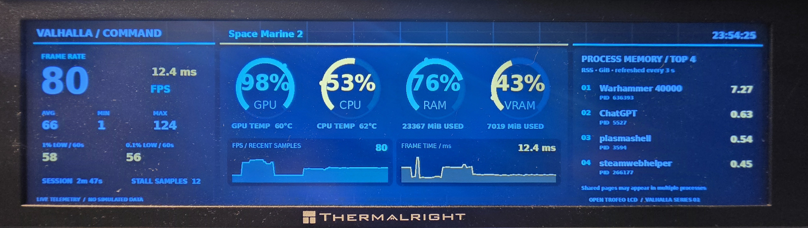
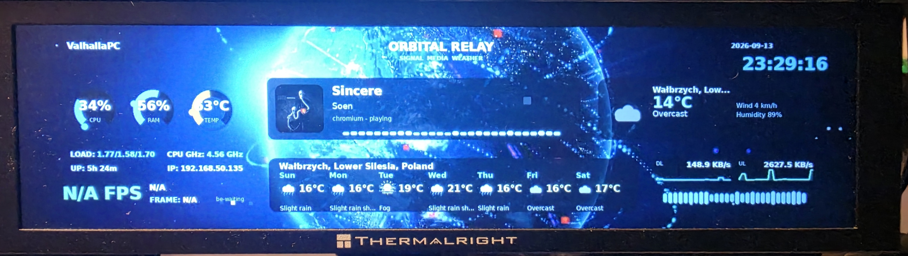
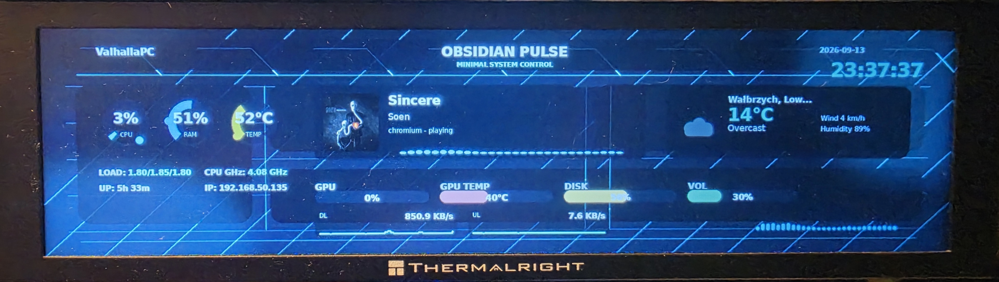

# Open Trofeo LCD

Linux dashboard, theme studio and gaming telemetry companion for the
**Thermalright Trofeo Vision 9.16-inch LCD** (`0416:5408`, 1920×462).

Open Trofeo LCD turns the ultrawide USB display into a live system panel instead
of leaving it dependent on the Windows-only Thermalright application. It can
show hardware and process statistics, weather, music and audio visualization,
and a dedicated gaming view with FPS and frame-time history.

> **Development preview**
>
> The application is usable on the author's machine, but it is still under
> active development. Hardware validation is currently limited to one physical
> Trofeo unit on Kubuntu. Expect UI changes and occasional regressions, and keep
> the original Thermalright software available as a recovery path.

## Features

| Area | Current capabilities |
|---|---|
| Themes | Theme Gallery, JSON themes, previews, duplication, import/export and ten bundled starter themes |
| Creation tools | Qt Theme Designer, layer controls, quick-add tools, auto-layout and Animation Studio |
| System telemetry | CPU/GPU/RAM/VRAM load, temperatures, frequency, storage, network activity, uptime and sparklines; NVIDIA and AMDGPU readings |
| Processes | Top processes by resident memory, refreshed without blocking the live display path |
| Media and audio | MPRIS now-playing metadata, album art, playback state, volume and CAVA spectrum/EQ bars |
| Weather | Open-Meteo current conditions, city search, Celsius/Fahrenheit setting, animated icons and a seven-day forecast; no API key required |
| Gaming | Native Vulkan FPS probe, frame time, session min/average/max, 1% and 0.1% lows, stutter count and per-session CSV logs |
| Automation | Automatic gaming-theme switching and restore, temporary `power-profiles-daemon` performance hold, and KDE Wayland VRR controls |
| Display runtime | Native PyUSB transfer path, optional `trcc-linux` integration, brightness control and USB recovery tooling |

MangoHud log reading is available only as an explicit fallback. It is not on the
critical path for backend status or normal live rendering.

## Compatibility and limitations

- Confirmed hardware: Thermalright Trofeo Vision 9.16-inch LCD, USB ID
  `0416:5408`, native resolution 1920×462.
- Confirmed operating system: Kubuntu on the author's desktop PC.
- A PikaOS tester reported that the application starts and theme selection works
  with a Radeon RX 7900 XTX. AMDGPU telemetry and Fahrenheit display have been
  added for a follow-up test; LCD output on that system is not yet confirmed.
- Other Ubuntu-family and Bazzite combinations remain unverified until hardware
  reports are collected.
- Gaming FPS capture currently targets Vulkan titles. Individual Proton games
  may still require launch-option or compatibility-layer tuning.
- KDE VRR controls use `kscreen-doctor`. The `Automatic` policy is recommended;
  forcing VRR continuously can make some desktop/display combinations flicker.
- The CPU performance option requests a temporary hold through
  `powerprofilesctl`; it does not write CPU governor files directly.
- This is an unofficial community project and is not affiliated with or
  endorsed by Thermalright.

## Project status

The current development tree includes ten live themes:

- Amber Hi-Fi
- Crimson Telemetry
- Kernel Console
- Neon Frame Arena
- Nordic Forecast
- Obsidian Pulse
- Orbital Relay
- Penguin Circuit
- Valhalla Command
- Verdant Bloom

Source/venv installation remains the primary route for early testers. A working
development DEB is built locally, but there is not yet a stable GitHub Release.
Experimental Flatpak and distribution-packaging notes are available in
`docs/flatpak.md` and `docs/linux-packaging.md`.

Before publishing a release, validate the tree with:

```bash
python3 scripts/check_linux_release.py
python3 scripts/trofeo_smoke_test.py
```

## Hardware photos

These are original photos of Open Trofeo LCD running on the physical test unit
under Kubuntu, not product renders.

### Valhalla Command — gaming telemetry



### Orbital Relay — music, weather and system telemetry



### Obsidian Pulse — music and desktop monitoring



## Acknowledgements and project provenance

Open Trofeo LCD began by building on and integrating
[`thermalright-trcc-linux`](https://github.com/Lexonight1/thermalright-trcc-linux)
by **Lexonight1 and its contributors**. That project provided the initial Linux
device-communication foundation and remains an important optional runtime path.

Open Trofeo LCD adds a separate Trofeo-focused application: its own Qt user
interface, 1920×462 renderer, theme library and creation tools, system/process
telemetry, weather and MPRIS widgets, audio visualization, Vulkan gaming
statistics, session logging and KDE gaming automation. The current code also
contains a native PyUSB transfer path tailored to the tested Trofeo unit.

This repository is not a GitHub fork of `thermalright-trcc-linux`; the wording
above describes code/runtime provenance and gives credit to the upstream work.

## Support

If this project is useful, you can support development here:

- GitHub Sponsors: https://github.com/sponsors/Abigor-DIY
- Repository: https://github.com/Abigor-DIY/Open-Trofeo-LCD

Bug reports should include the distribution, desktop session, GPU, Steam type
(native or Flatpak), `lsusb` ID and the relevant backend log excerpt.

## License

Open Trofeo LCD project code is licensed under the GNU General Public License
version 3.0 only (`GPL-3.0-only`). See `LICENSE`.

`trcc-linux` is distributed under `GPL-3.0-or-later`. Other third-party
dependencies keep their own licenses. Review `docs/third-party-licenses.md`
before publishing binary packages, and preserve upstream copyright/license
notices for any copied source material.

## Trofeo protocol notes

The table and packet notes below document the tested `0416:5408` device. They
combine observations from this project's USBPcap/Wireshark captures with
implementation experience gained while integrating `trcc-linux`; they should
not be read as a claim that all Thermalright protocol work originated here.

| Parameter       | Value                                    |
|-----------------|------------------------------------------|
| VID:PID         | `0416:5408` (Winbond Electronics Corp.)  |
| USB Class       | Vendor Specific (0xFF)                   |
| EP OUT          | 0x09 (Bulk, 512B max packet)             |
| EP IN           | 0x81 (Bulk, 512B max packet)             |
| Resolution      | 1920×462 pixels                          |
| Image format    | JPEG (baseline, 4:2:0)                   |
| Frame rate      | ~6.3 FPS (TRCC default)                  |
| Frame size      | ~310–320 KB per JPEG                     |

### Packet Structure

Each JPEG is split into chunks sent as USB bulk transfers:

```
Standard chunk: 4096 bytes total
  [0]       0x01        Command (send image)
  [1]       0xFF        Marker
  [2..5]    uint32 LE   JPEG total size / frame metadata
  [6]       0x00        Fixed
  [7]       0xF0        Fixed
  [8]       0x01        Fixed
  [9]       0x01        Fixed
  [10]      N           Frame counter (low byte, wraps)
  [11]      seq         Sequence within frame (0x00, 0x08, 0x10, ...)
  [12..15]  0x00        Padding
  [16..4095]            JPEG data (4080 bytes)

Final chunk:
  In captures this often appeared as a 2048-byte transfer, but that detail is still
  the least certain part of the protocol. The driver therefore supports multiple
  final-packet strategies for live testing:
  - `auto`: final packet size = 16-byte header + remaining JPEG data
  - `pad-2048`: zero-pad final packet to 2048 bytes
  - `pad-4096`: zero-pad final packet to 4096 bytes
```

After each packet, the host reads a 512-byte ACK from EP1 IN.

## Installation

### Dependencies

```bash
# Kubuntu / Ubuntu / Debian
sudo apt install python3-venv python3-pip python3-usb python3-pil playerctl ffmpeg cava mangohud

# Python dependencies used by the backend, renderer and GUI
python3 -m venv .venv-gui
.venv-gui/bin/pip install -r requirements.txt

# Helper script for the Qt GUI venv
scripts/setup_gui_venv.sh

# Optional but recommended for "Now Playing" widget (MPRIS metadata)
# (Spotify / Chromium / YT Music web / etc.)
playerctl -v

# Optional but recommended for real-time EQ bars in Now Playing / Graphic EQ
cava -v

# Optional fallback only for game FPS widgets
mangohud --version
```

For live FPS widgets without an on-screen overlay, use the Open Trofeo FPS probe
socket described in `docs/gaming-fps-probe.md`. MangoHud log reading is disabled
by default and remains an explicit fallback only.

Native Vulkan FPS probe for quick testing:

```bash
scripts/build_fps_probe.sh
scripts/install_fps_layer_user.sh
```

For Steam Flatpak, the installer also grants the game sandbox access to the
backend FPS socket. If this needs to be repaired manually:

```bash
scripts/configure_steam_flatpak_fps.sh
```

Steam installed from a DEB package does not need the Flatpak socket override.

Python packages are tracked in `requirements.txt`:
- `PySide6` for the Qt GUI
- `pyusb` for USB communication
- `Pillow` for image rendering
- `opencv-python-headless` for animation stabilization tools
- [`trcc-linux`](https://github.com/Lexonight1/thermalright-trcc-linux)
  for the optional TRCC-compatible device path

### USB Permissions

The LCD identifies as `0416:5408`. Install the udev rule before running the GUI
as a normal user. Without this rule, the app may require root or fail with
permission errors.

### Udev Rule

```bash
sudo cp 99-trofeo-lcd.rules /etc/udev/rules.d/
sudo udevadm control --reload-rules
sudo udevadm trigger
```

After this, unplug and replug the LCD.

### Verify Device

```bash
lsusb | grep 0416
# Should show: Bus XXX Device XXX: ID 0416:5408 Winbond Electronics Corp.
```

## Usage

```bash
# Test pattern (color bars)
python3 trofeo_lcd.py --test

# Test pattern with packet plan printed
python3 trofeo_lcd.py --test --packet-debug

# Try the 2048-byte padded final packet variant
python3 trofeo_lcd.py --test --final-packet-mode pad-2048

# Send a custom image
python3 trofeo_lcd.py my_image.png

# Send an existing JPEG byte-for-byte without re-encoding
python3 trofeo_lcd.py --raw-jpeg-passthrough reference_frame_trcc.jpg

# System monitoring mode (auto-refresh)
python3 trofeo_lcd.py --monitor

# Loop an image every 2 seconds
python3 trofeo_lcd.py --loop --interval 2.0 wallpaper.jpg

# Lower JPEG quality for faster transfers
python3 trofeo_lcd.py --monitor --quality 70
```

In `--monitor` mode the driver displays live Linux data:
- CPU usage (delta `/proc/stat`, without a blocking sleep)
- per-core summary (avg/max)
- CPU frequency (`/proc/cpuinfo`)
- CPU temperature (best-effort from `thermal`/`hwmon`)
- load average (`/proc/loadavg`)

## Stage 2.1: Service Runtime (systemd user)

This stage runs stable replay in the background with auto-restart and file logging, without manually running a long command.

### 1) Install the user service

```bash
scripts/trofeo_service.sh install
```

This creates:
- `~/.config/systemd/user/trofeo-lcd.service`
- local config: `.trofeo-service.env` based on `.trofeo-service.env.example`

### 2) Start, status and logs

```bash
scripts/trofeo_service.sh start
scripts/trofeo_service.sh status
scripts/trofeo_service.sh logs
```

Note:
- Do not use `sudo` with `systemd --user`.
- If `start` fails, the script automatically prints `status` and the latest `journalctl` lines.

File log:
- `~/.local/state/open-trofeo-lcd/service.log`

### 3) Autostart after login

```bash
scripts/trofeo_service.sh enable
```

### 4) Stop / restart

```bash
scripts/trofeo_service.sh stop
scripts/trofeo_service.sh restart
```

### Configuration

Edit `.trofeo-service.env`:
- `PCAP_FILE` (default: `dzis.pcapng`)
- `FRAME_INDEX`
- timing: `ACK_TIMEOUT_MS`, `INTER_PACKET_DELAY`, `FRAME_DELAY`
- connection retry: `CONNECT_RETRIES`, `CONNECT_RETRY_DELAY`

## Stage 2.2: Backend API (for the Qt GUI)

The backend exposes a local HTTP API and manages the replay worker itself.

### 1) Install and start the backend

```bash
scripts/trofeo_backend_service.sh install
scripts/trofeo_backend_service.sh start
scripts/trofeo_backend_service.sh status
scripts/trofeo_backend_service.sh logs
```

For the DEB packaged app, the backend user service is installed globally as
`trofeo-backend.service`. If a source checkout previously installed a per-user
unit in `~/.config/systemd/user`, refresh it from the package wrapper once:

```bash
open-trofeo-lcd --install-backend-service
systemctl --user restart trofeo-backend.service
```

Note:
- `trofeo_backend_service.sh start` stops the old `trofeo-lcd.service` to avoid `Resource busy` conflicts.
- Do not use `sudo` with `systemd --user`.

### 2) Key endpoints

```bash
# backend and worker status
curl -s http://127.0.0.1:18777/v1/status

# start the replay loop
curl -s -X POST http://127.0.0.1:18777/v1/start

# stop the replay loop
curl -s -X POST http://127.0.0.1:18777/v1/stop

# change frame index (restarts the worker if running)
curl -s -X POST http://127.0.0.1:18777/v1/set-frame \
  -H 'Content-Type: application/json' \
  -d '{"frame_index": 10}'

# send one image and return to the loop
curl -s -X POST http://127.0.0.1:18777/v1/send-image \
  -H 'Content-Type: application/json' \
  -d '{"path":"reference_frame_trcc.jpg","raw_jpeg_passthrough":false,"resume_loop":false}'
```

### 3) Backend configuration

File: `.trofeo-backend.env`
- `HOST`, `PORT`
- `PCAP_FILE`, `FRAME_INDEX`
- timing/retry: `ACK_TIMEOUT_MS`, `INTER_PACKET_DELAY`, `FRAME_DELAY`, `CONNECT_RETRIES`, `CONNECT_RETRY_DELAY`
- `THEMES_FILE` (default: `.trofeo-themes.json`)
- `PLAYLIST_FILE` (default: `.trofeo-playlist.json`)
- `AUTOSTART=1` starts replay immediately when the backend starts
- optional weather data for widgets:
  - `OPEN_TROFEO_WEATHER_LAT`
  - `OPEN_TROFEO_WEATHER_LON`
  - `OPEN_TROFEO_WEATHER_LOCATION`
  - `OPEN_TROFEO_WEATHER_REFRESH_S` (default: `900`)

Weather uses Open-Meteo by default and does not require an API key. Leave
latitude/longitude empty to keep weather sources disabled.

## Stage 2.3: Qt GUI Client

Minimal Qt panel for controlling the backend API:
- status runtime (`mode/running/pid/uptime/error`)
- `start/stop/restart/scan`
- change `frame_index`
- `send-image`
- edit basic backend config (`pcap`, timing)

### Start GUI

```bash
scripts/run_trofeo_gui.sh
```

Optionally use a different backend URL:

```bash
scripts/run_trofeo_gui.sh http://127.0.0.1:18777
```

Files:
- `trofeo_gui.py`
- `scripts/run_trofeo_gui.sh`
- `scripts/setup_gui_venv.sh`

## Stage 2.4: Theme Manager

The backend and GUI include a theme preset manager:
- save presets to `.trofeo-themes.json`
- `add/update/remove`
- one-click `apply` for a selected theme

API endpoints:

```bash
# list themes
curl -s http://127.0.0.1:18777/v1/themes

# add or update a theme
curl -s -X POST http://127.0.0.1:18777/v1/themes/add \
  -H 'Content-Type: application/json' \
  -d '{"name":"dark_ref","path":"reference_frame_trcc.jpg","raw_jpeg_passthrough":false}'

# remove a theme
curl -s -X POST http://127.0.0.1:18777/v1/themes/remove \
  -H 'Content-Type: application/json' \
  -d '{"name":"dark_ref"}'

# apply theme (optionally resume loop)
curl -s -X POST http://127.0.0.1:18777/v1/themes/apply \
  -H 'Content-Type: application/json' \
  -d '{"name":"dark_ref","resume_loop":false}'

# apply with a longer API request timeout (optional)
curl -s -X POST http://127.0.0.1:18777/v1/themes/apply \
  -H 'Content-Type: application/json' \
  -d '{"name":"dark_ref","resume_loop":false,"timeout_s":90}'
```

## Stage 2.5: Playlist / Scheduler

The backend and GUI support a theme playlist, animated by sequentially switching presets:
- list of entries `{name, duration_s}`
- `start/stop` playlist
- saved to `.trofeo-playlist.json`

API endpoints:

```bash
# playlist preview
curl -s http://127.0.0.1:18777/v1/playlist

# add an entry (theme must exist)
curl -s -X POST http://127.0.0.1:18777/v1/playlist/add \
  -H 'Content-Type: application/json' \
  -d '{"name":"dark_ref","duration_s":3.5}'

# remove an entry by index
curl -s -X POST http://127.0.0.1:18777/v1/playlist/remove \
  -H 'Content-Type: application/json' \
  -d '{"index":0}'

# start/stop the scheduler
curl -s -X POST http://127.0.0.1:18777/v1/playlist/start
curl -s -X POST http://127.0.0.1:18777/v1/playlist/stop
```

## Stage 2.6: Bundle Import / Export

A bundle is a `themes + playlist` configuration snapshot stored in one JSON file.

API endpoints:

```bash
# export bundle as JSON in the response
curl -s http://127.0.0.1:18777/v1/bundle/export

# save bundle to a file
curl -s -X POST http://127.0.0.1:18777/v1/bundle/save \
  -H 'Content-Type: application/json' \
  -d '{"path":".trofeo-bundle.json"}'

# load bundle (replace)
curl -s -X POST http://127.0.0.1:18777/v1/bundle/load \
  -H 'Content-Type: application/json' \
  -d '{"path":".trofeo-bundle.json","merge":false}'

# load bundle (merge)
curl -s -X POST http://127.0.0.1:18777/v1/bundle/load \
  -H 'Content-Type: application/json' \
  -d '{"path":".trofeo-bundle.json","merge":true}'
```

## Troubleshooting

**Device not found:**
- Check `lsusb | grep 0416`
- Make sure no other program (e.g. TRCC under Wine) is using the device
- Try `sudo python3 trofeo_lcd.py --test`

**Permission denied:**
- Install the udev rule (see above)
- Or run with `sudo`

**Image does not change at all:**
- Try `--final-packet-mode pad-2048`
- If that still fails, try `--final-packet-mode pad-4096`
- Compare packet plans with `--packet-debug`
- Per-packet ACK is required and is now the default behavior
- Also test a small delay, e.g. `--inter-packet-delay 0.01`

**LCD freezes after deep sleep / suspend:**
- Symptoms can include an old date/time stuck on the LCD, frozen EQ/stat widgets,
  `USBTimeoutError`, `resolution (0,0)`, or GUI errors such as
  `Remote end closed connection without response`.
- First try **Configuration → Quick Actions → LCD USB Recovery (sudo)** in the
  app. It opens a terminal, stops the user backend service, runs:
  `sudo /usr/share/open-trofeo-lcd/scripts/trofeo_usb_power_cycle.sh`, then
  restarts the backend.
- From a source checkout the same script is:
  `sudo scripts/trofeo_usb_power_cycle.sh`.
- A normal PC reboot usually helps because the USB device is enumerated again.
  If the motherboard keeps USB powered during standby, a full power-off for a few
  seconds is stronger than a warm reboot.
- Physical replug is the last resort, mainly when the hub/firmware refuses a
  software reset.

**Image looks wrong:**
- The LCD is 1920×462 — ultra-wide. Images are auto-resized
- Try `--quality 90` for better image quality
- If you have a known-good TRCC JPEG, use `--raw-jpeg-passthrough` to test USB protocol separately from JPEG generation

## Local capture work

In addition to using the upstream `trcc-linux` work, this project performed its
own interoperability testing against the author's physical Trofeo unit:

1. USBPcap + Wireshark on Windows, capturing while the vendor TRCC application was running.
2. The device appeared on a separate USB root hub (USBPcap1) from where it was physically plugged in (USBPcap4); the Terminus Tech `1a40:0101` hub routed it there.
3. Analysis of 83,512 packets found 524 JPEG frames sent at approximately 6.3 FPS.
4. Each observed frame was a 1920×462 baseline JPEG split into USB bulk transfers with a 16-byte header.
5. No separate complex initialization sequence was identified in that capture. The exact meaning of several header bytes and the final-packet shape remains uncertain.

These observations describe the tested capture only and do not supersede or
claim ownership of upstream protocol research.

## Disclaimer

This software and its local capture work are provided for interoperability and
experimentation. Use it at your own risk; display firmware and USB behavior may
differ between hardware revisions.
