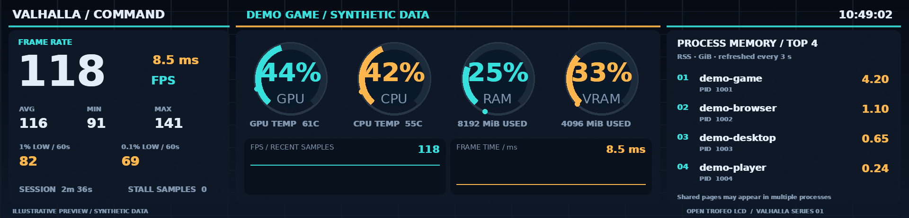
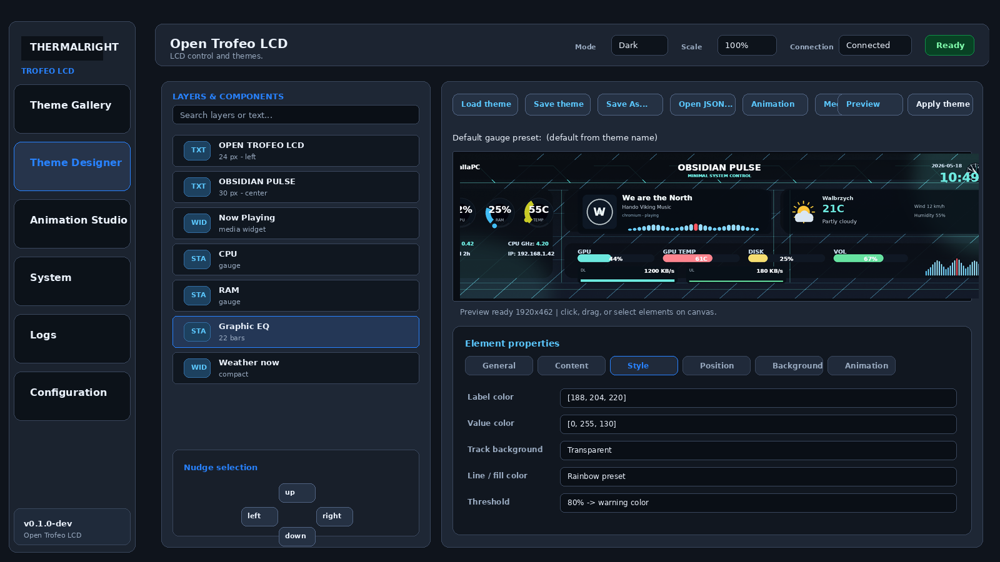
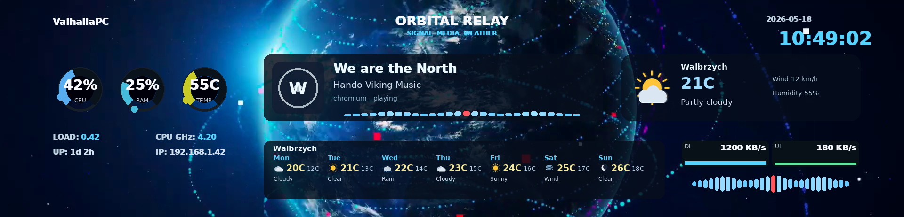

# Open Trofeo LCD — collaboration overview

Independent open-source Linux software for the Thermalright Trofeo display.
The project began when its developer bought a Trofeo and could not use its
display with the software available to them on Linux.

## Current capabilities

- Seven themes, visual theme editing and animated backgrounds.
- CPU/GPU usage, temperatures, RAM/VRAM and per-process resident memory.
- FPS and frametime telemetry, session statistics and CSV logging.
- Automatic theme switching when game telemetry is detected.
- Media information, audio visualization, volume and weather widgets.
- Locally tested DEB packaging and USB worker handoff safeguards.

These are software screenshots/renders, not photographs of physical hardware.
Theme previews use illustrative data; UI screenshots show an earlier version.
A hardware photograph or live demonstration can provide additional evidence
without presenting preview numbers as benchmark results.

## Validation boundary

Hardware testing covers one Trofeo on Ubuntu/Kubuntu 26.04, including Space
Marine 2 telemetry and Valhalla/Orbital switching. Other models are not yet
validated. The developer has access to Bazzite; testing there and on
SteamOS-style systems remains future work. FPS requires integration setup.

## Proposed pilot

Start with one additional model and agree on deliverables after a compatibility
assessment. Useful support includes development samples, protocol documentation,
a technical contact, and sponsorship or funded implementation/testing milestones.
A loaned or sponsored gaming test system could enable broader Linux validation.

This is an independent GPL-3.0-only project. No official Thermalright or Valve
partnership, endorsement or certification is implied.
